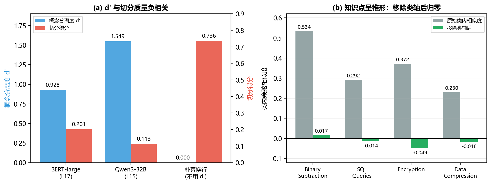
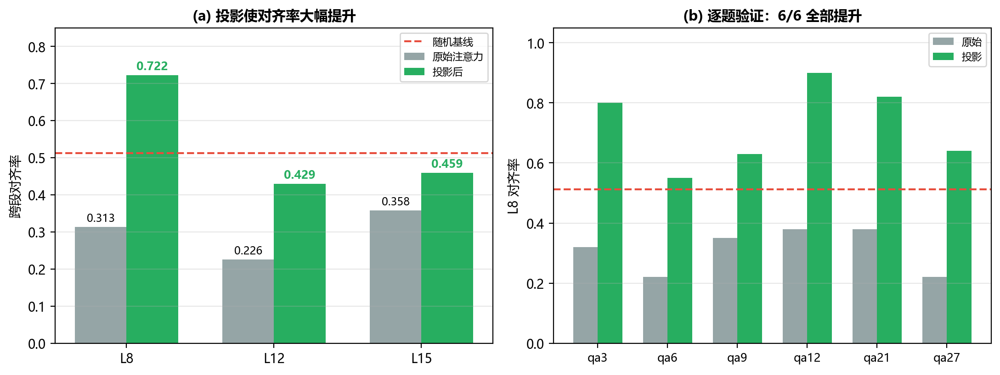
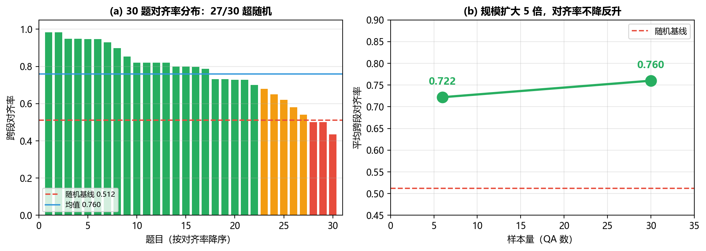
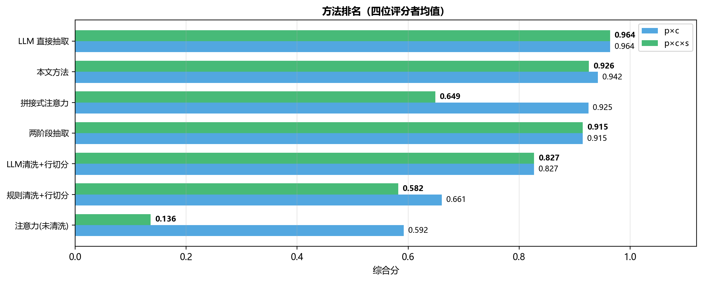

# 知识点切分中的两次迁移

**——从几何代理指标到直接指标，从隐藏层到投影注意力**

> 论文全文见 [paper-two-migrations.pdf](paper-two-migrations.pdf) / [paper-two-migrations.docx](paper-two-migrations.docx)

---

## 摘要

本文报告考试评分方案知识点切分任务上的一次方法演进。演进由两次迁移驱动。第一次是评价指标的迁移：此前使用的四类几何代理指标（概念分离度 d'、轮廓系数、簇内一致性、片段自足性）与切分质量无可靠关联，其中 d' 与质量负相关；改用人工评分的三项直接指标（纯度、齐全度、单一性）后，优化方向才变得明确。第二次是技术路线的迁移：从基于嵌入的聚类，经编码器隐藏层，最终转向大模型注意力；关键突破在于将多头注意力经输出投影矩阵 W_o 变换，使题目—答案对齐率从 0.313 提升至 0.722。在 30 题规模上验证，对齐率升至 0.760，27/30 超过随机基线。最终切分方法达到纯度 0.942、齐全度 1.000、单一性 0.983，综合分 p×c×s = 0.926。

**关键词**　知识点切分；评价指标；注意力投影；方法演进

---

## 1　引言

考试评分方案（Mark Scheme）以连续文本给出得分点。构建知识点图谱需将其切分为离散语义单元。困难在于：知识点是语义单元，文本是线性序列；一个知识点可能跨越多句，也可能被题号、分值、项目符号打断。

本文记录该任务上评价指标与技术路线的两次调整，以及调整后的结果。

## 2　数据

### 2.1　来源与规模

语料取自 Cambridge International AS & A Level Computer Science（科目代码 9618）的历年真题。每份试卷由题目卷（Question Paper, QP）与评分方案（Mark Scheme, MS）配对构成，经 PDF 解析与题目—答案配对后得到 517 组问答对。

**表 1　语料构成**

| 项目 | 数量 |
|---|---|
| 试卷数 | 65 |
| 问答对总数 | 517 |
| 考试季 | 2021 Jun – 2024 Nov（8 个考季） |
| 试卷类型 | Paper 1/2/3/4（组件 11–13、21–23、31–33） |
| 题目文本平均长度 | 2619 字符（中位数 2427） |
| 答案文本平均长度 | 992 字符（中位数 868） |

试卷覆盖 8 个考季：2021 Jun 9 份、2021 Nov 8 份、2022 Jun 9 份、2022 Nov 9 份、2023 Jun 9 份、2023 Nov 9 份、2024 Jun 9 份、2024 Nov 3 份。组件分布为：11（33）、12（35）、13（37）、21（14）、22（17）、23（16）、31（41）、32（39）、33（34）。

### 2.2　过滤

原始语料含大量代码题与图表题。这两类题目的答案以代码块或表格形式呈现，其结构由语法或行列决定，与知识点的语义边界无关，会干扰切分方法的评估。因此将其剔除。

代码题的判定标准为：答案或题目中出现三个以上代码关键词（汇编指令如 LDM、LDD、STO，伪代码关键字如 FOR、WHILE、IF、RETURN，SQL 关键字如 SELECT、FROM、WHERE，类型声明如 int、string、bool，以及赋值与比较运算符）。图表题的判定标准为：答案中出现四行以上连续纯数字行。

**表 2　过滤结果**

| 类别 | 数量 | 占比 |
|---|---|---|
| 原始 | 517 | 100% |
| 保留（纯文本） | 266 | 51.5% |
| 剔除（代码题） | 214 | 41.4% |
| 剔除（图表题） | 37 | 7.2% |

过滤后保留 266 组问答对，答案平均 992 字符，中位数 868，最大 3028。保留的题目覆盖定义题、流程题、比较题、计算题等纯文本题型。

### 2.3　清洗

评分方案文本含题号、分值标记、页眉页脚、PDF 字体乱码等噪声。规则清洗无法区分表格噪声与数值答案：例如表头 `100 101 110 111 112` 应删除，而二进制答案 `1000 1100` 应保留，二者均为纯数字行。因此改用 LLM 执行仅删除操作，并施加严格约束：输出的每个字符必须按原顺序出现在输入中，不得合并行、不得重排、不得改变保留片段内的空白。

以 token 子序列检查验证，6 组抽样全部通过，逐字命中率 100%。

### 2.4　评估子集

切分质量的人工评估在 6 组问答对上进行，覆盖定义题（图论与监督学习）、流程题（缓冲区输出顺序）、比较题（IDE 功能与压缩）、表格题（追踪表与汇编器）、布尔代数题、汇编寻址题。这 6 组在题型上互补，且包含规则清洗易误删的边界情况。

对齐率的规模验证在 30 组上进行，取自过滤后语料的前 30 个。

## 3　评价指标

### 3.1　初始指标及其问题

研究初期使用四类可从数据自动计算的几何指标：概念分离度 d'、聚类轮廓系数、簇内一致性、片段自足性。它们无需人工标注，便于快速迭代。

**表 3　四类初始指标及其失效原因**

| 指标 | 测量对象 | 失效证据 |
|---|---|---|
| 概念分离度 d' | 全局概念可分性 | d' 最高者切分最差 |
| 轮廓系数 | 簇内紧凑度 | 随簇数单调上升，无峰值 |
| 簇内一致性 | 向量方向对齐 | 97–113% 相似度来自共享轴 |
| 片段自足性 | 语义完整性 | 预测力全部来自长度 |

d' 与切分质量呈负相关。BERT-large 第 17 层 d'=0.928，切分得分 0.201；Qwen3-32B 第 15 层 d'=1.549，切分得分仅 0.113；而不使用 d' 的朴素换行切分达到 0.736。原因是 d' 测量全局可分性，切分需要局部边界可检测性，二者正交：全局 d'=0.928，相邻 d'=0.237。



**图 1　初始指标的失效**　(a) d' 与切分质量负相关；(b) 知识点呈锥形，移除类轴后类内相似度归零。

簇内一致性同样失效。对主题质心 c，设轴 u=c/‖c‖，移除 u 方向后类内相似度归零：Binary Subtraction 从 0.534 降至 0.017，SQL Queries 从 0.292 降至 −0.014，Encryption 从 0.372 降至 −0.049。97–113% 的类内相似度来自共享轴。高一致性仅说明共享轴对齐：两个不同知识点只要同属一个主题，一致性就会很高。

片段自足性的预测力全部来自长度。语境不变性与长度的相关为 +0.675，控制长度后与纯度的偏相关仅 +0.080；内部凝聚与长度相关 +0.574，控制后 +0.084。但质量并非长度的函数：长度仅解释 8% 的方差，同一长度带内质量从 0.10 波动到 0.90。真实语义信号存在，只是几何指标无法捕捉。

### 3.2　改用直接指标

上述指标的共同问题是：它们测量几何性质，而目标是知识点质量，二者之间没有稳定映射。因此改用三项直接指标：纯度 p（片段中知识点内容的占比）、齐全度 c（覆盖该题实际考察知识点的比例）、单一性 s（只含一个知识点的片段比例）。综合分为 p×c 与 p×c×s。

噪声定义为题号、分值标记、页眉、PDF 乱码、其他知识点。代码与汇编指令属于考纲内容，不计为噪声；语法不完整、被截断、不连续不扣分。

代价是必须人工评分。四位独立评分者（一位主评分者、三位独立子智能体）逐片段判定，排序完全一致，说明指标本身稳定。改用直接指标后，每一步改动都有可验证的收益。

**表 4　各环节的指标贡献**

| 环节 | 指标 | 贡献 |
|---|---|---|
| LLM 受限清洗 | p×c | +0.193 |
| 禁止拼接 | 单一性 | +0.281 |
| 输出投影 | 对齐率 | +0.409 |
| LLM 门控 | 综合分 | 20.5 / 30 |

## 4　技术路线

### 4.1　基于评分结构的切分

最初按评分标记（项目符号、双斜线、MP 编号）切分，得到 2413 个片段。问题在于切分依据是评分结构而非语义结构：一个片段可含多个知识点，一个知识点也可被切成多个片段。

### 4.2　嵌入聚类

改用句向量编码片段后聚类。三项改进（去评分模板、换编码器、去各向异性）使纯度从 0.293 提升至 0.386，但远不足够。此阶段得到一个关键认识：分词决定聚类上限。同一批数据，硬切分纯度 0.386，LLM 抽取的完整概念纯度 0.720。聚类算法无法弥补切分的缺陷。

### 4.3　编码器隐藏层

转而假设更大模型的隐藏层能更好捕捉概念结构。层扫描显示选层比选模型更重要：BERT-large 第 17 层 d'=0.928，最后一层仅 0.098。但隐藏层无法用于切分。相邻相似度标准差仅 0.103，且最低点系统性地落在标点处。

原因是标点为语法符号，语义内容极少，向量方向随机；实义词共享语义空间。切分算法因此系统性偏向标点。

### 4.4　注意力与输出投影

Qwen3-32B 的 d' 达 1.549，但切分得分仅 0.113。此阶段重新定义了任务：此前只计算评分方案内部注意力，但真正的问题是「题目与答案如何对应」。将题目与评分方案拼接后输入，提取跨段注意力。结果仍不理想：原始跨段对齐率 0.313，低于随机基线 0.512，注意力系统性偏向功能词与标点。

原始注意力 A_h[i,j] 是 softmax 权重，仅表示「头 h 认为 token i 应关注 token j」，不含该信息对输出的实际贡献。引入输出投影矩阵 W_o：

```
P[i,j] = || Σ_h A_h[i,j] · (V_h[j] @ W_o,h) ||
```

P[i,j] 表示 token i 从 token j 处实际聚合到的信息量。实现上用 Gram 矩阵避免构造 5120 维向量，复杂度由 O(T²·5120) 降至 O(T²·N_H)。



**图 2　投影注意力**　(a) 投影使 L8 对齐率从 0.313 提升至 0.722；(b) 逐题验证 6/6 全部提升。

逐题验证 6/6 全部优于原始。投影后 top-20 被对齐 token 高度集中于该题核心知识点：数据库题集中于 Primary Key、Foreign Key、relationships；网络题集中于 Wireless、Freedom of movement、physical connection。

原因是原始注意力被语法连接主导：功能词与所有词强相关，权重高但经 W_o 投影后贡献很小。投影抑制语法连接，放大语义连接。

### 4.5　规模验证

6 题的样本过小，0.722 可能含偶然性。将规模扩大至 30 题（从 266 个过滤后的题目中取前 30 个），对齐率不降反升。

**表 5　规模验证**

| 指标 | 6 题 | 30 题 |
|---|---|---|
| 平均对齐率 | 0.722 | 0.760 |
| 超随机比例 | 6/6 (100%) | 27/30 (90%) |
| 良好比例（>0.7） | — | 21/30 (70%) |
| 优秀比例（>0.9） | — | 7/30 (23%) |
| 塌缩度（top5 集中度） | — | 0.089 |



**图 3　规模验证**　(a) 30 题对齐率分布，27/30 超过随机基线；(b) 规模扩大 5 倍，对齐率不降反升。

6 题时 100% 超随机，30 题时 90%，属正常的统计回归。6 个样本全超随机的概率约 1.6%，说明 6 题的结果偏乐观；30 题的 90% 更可信。

塌缩度均值 0.089，远低于 0.35 的塌缩阈值，说明投影注意力是分散对齐而非塌缩到少数 token。但末尾汇聚均值 0.316，约三分之一的注意力指向评分方案末尾 20 个 token，该处常为评分说明，需在后续工作中区分语义对齐与注意力汇聚。

### 4.6　两条工程约束

禁止拼接。拼接式切分会引入跨概念混合，而纯度指标无法察觉（拼接两端均为真实内容 token）。施加「输出必须是原文连续子串」的硬约束后，单一性从 0.702 提升至 0.983。

平衡约束。在稠密注意力矩阵上，无约束的最小割会退化：实测得到 7 个极小片段与 1 个含剩余 150 词的巨大片段。施加段长约束 [0.5L̄, 2L̄] 后恢复正常。

## 5　结果

表 6 给出最终排名。本文方法在 p×c×s 上达到 0.926，仅次于 LLM 直接抽取（0.964）。

**表 6　方法排名（四位评分者均值）**

| 排名 | 方法 | 纯度 | 齐全度 | 单一性 | p×c | p×c×s |
|---|---|---|---|---|---|---|
| 1 | LLM 直接抽取 | 0.987 | 0.976 | 1.000 | 0.964 | 0.964 |
| 2 | **本文方法** | 0.942 | 1.000 | 0.983 | 0.942 | **0.926** |
| 3 | 拼接式注意力切分 | 0.925 | 1.000 | 0.702 | 0.925 | 0.649 |
| 4 | 两阶段抽取—重写 | 0.925 | 0.988 | 1.000 | 0.915 | 0.915 |
| 5 | LLM 清洗 + 行切分 | 0.856 | 0.967 | 1.000 | 0.827 | 0.827 |
| 6 | 规则清洗 + 行切分 | 0.851 | 0.776 | 0.881 | 0.661 | 0.582 |
| 7 | 注意力切分（未清洗） | 0.592 | 1.000 | 0.229 | 0.592 | 0.136 |



**图 4　方法排名**

## 6　讨论

切分质量的评估仍限于 6 题。对齐率已在 30 题上验证，但纯度、齐全度、单一性需要逐片段人工判定，成本较高。

短文本过碎。48 词的题目切 10 段导致表达式被切断。评分说明无概念结构，`One mark for …` 类文本被切碎，因其本身不承载知识点。

投影注意力尚未用于切分。目前仅用于对齐，对齐强度尚未转化为切分打分。

## 7　结论

本文记录知识点切分任务上评价指标与技术路线的两次调整。

指标方面，四类几何代理指标与目标无可靠关联，其中 d' 与质量负相关；改用人工验证的纯度、齐全度、单一性后，优化方向才变得明确。

技术路线方面，从基于评分结构的切分，经嵌入聚类与编码器隐藏层，最终转向大模型注意力；关键是将多头注意力经输出投影矩阵变换，使对齐率从 0.313 提升至 0.722，并在 30 题规模上验证为 0.760。

最终切分方法达到 p×c×s = 0.926，仅次于 LLM 直接抽取（0.964）。

## 参考文献

[1] Qwen Team. Qwen3 Technical Report. 2025.
